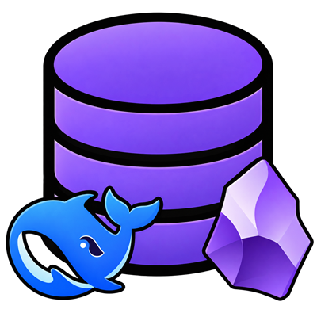

<p align="center">
  
</p>

# obsidian-kb-toolkit

**把散落一地的文档，变成可检索、可复习、可长期维护的 Obsidian 知识库。**
一套**零依赖**的 Node 工具（41 个脚本）+ 五个 **agent skill**（从零建库 / 长线运维 / 单词卡片 / 作业批改 / 讲题落库）。

> Turn scattered documents (PDF / Word / spreadsheets / AI chat exports / photo notes) into a searchable Obsidian knowledge base — with spaced-repetition review and agent-driven long-term maintenance. 41 plain Node scripts, **no npm dependencies** (Node standard library only).

[English summary](#english-summary) · [设计原则](#三个设计原则) · [快速开始](#快速开始) · [工具清单](#工具清单41-个) · [五个-skill](#五个-agent-skill) · [日常运维](#日常运维) · [已知的坑](#已知的坑)

---

## 它解决什么问题

你大概有一堆资料散在各个盘里：教材 PDF、作文 Word、试卷、截图笔记、和 AI 的历史对话、手机拍的学习笔记……**找起来靠翻文件夹，整理起来靠手工，背单词又是另一个 App。**

这个工具包给出一条**可重复、可验收**的流水线：

```
散落文件
   │  scan            登记路径 + 指纹（不复制原件）
   ▼
index/catalog.jsonl ── extract ──▶ cache/text/（抽出正文，供检索与核对）
   │
   ├─▶ notes/       摘要卡（人 + agent 写，带 key_points 与原文出处）
   ├─▶ materials/   素材库（从对话里**逐字搬运**的成品段落）
   ├─▶ vocab/       单词库（一词一笔记，含释义 / 批注 / 例句 / 出处）
   │        └─▶ review/   复习卡（Obsidian Spaced Repetition，间隔重复）
   └─▶ digests/     成品（综述 + 导出的 Word / Excel）
```

每一步都有**验收器**：`verify-fresh` / `link-notes` / `obsidian-check` / `check-yaml` / `check-math` / `check-docx`。

## 三个设计原则

**这三点决定了它为什么不容易烂**（都是踩过坑总结出来的）：

1. **只登记路径，不动原件。** 磁盘上的原始文件永远只读，知识库保存「路径 + sha256 + 摘要」。冲突时以原件为准。
2. **搬运，而非重写。** 素材与词条的正文是**原文逐字片段**，脚本只负责切分和贴标签。一旦让模型"总结成素材库"，你就再也分不清哪句是原文、哪句是二手生成。
3. **派生层可重建，用户资产不可覆盖。** `cache/` `fulltext/` `materials/` `vocab/` 随便重跑；`notes/` 的手写卡片和 `review/` 的复习进度（间隔重复插件把进度写成 HTML 注释留在卡片行尾）**只能只增不改** —— 重写整文件等于抹掉学习记录。

## 快速开始

### 方式 A：交给 agent（推荐）

把 `skills/` 下两个目录拷进你的 agent 应用的 skills 目录：

| 应用 | 放置位置 |
| --- | --- |
| DSH (DeepSeek Harness) | `~/.dsh/skills/` |
| Claude Code / 其他支持 Agent Skills 约定的应用 | 对应 skills 目录（`SKILL.md` 用 `name` + `description` front matter） |

然后直接说：

> 用 kb-starter 在 `D:\my-kb` 从零建一个知识库，原文目录是 `D:\学习` 和 `D:\论文`

agent 会自己 bootstrap → 验收 → 登记 → 抽正文 → 建卡 → 出索引。

### 方式 B：手工跑（5 分钟建骨架）

```bash
git clone https://github.com/MWRON2242/obsidian-kb-toolkit.git
cd obsidian-kb-toolkit

# 1) 建骨架（先问清楚库放哪，再执行）
node skills/kb-starter/scripts/bootstrap.mjs --kb="D:\my-kb" --name="我的知识库" --roots="D:\学习,D:\论文"

# 2) 验收（8 项，别跳过）
node "D:\my-kb\tools\verify-fresh.mjs" --kb="D:\my-kb"

# 3) 登记 + 抽正文
cd D:\my-kb
node tools/scan.mjs
node tools/extract-text.mjs --all

# 4) 读 cache/text/<id>.txt 写 notes/<id>-<slug>.md（这一步交给人或 agent）

# 5) 校验 + 出索引 + 同步到 Obsidian
node tools/link-notes.mjs
node tools/build-index.mjs
node tools/obsidian-sync.mjs

# 6) 一屏看板
node tools/status.mjs
```

`bootstrap` 的特性：**只补缺失，不删不改**（已存在的文件跳过，`--force` 才覆盖，`--dry` 只打印计划）。

### 方式 C：只用工具

`tools/` 里的 34 个脚本是**独立可用**的，不依赖 skill：

```bash
node tools/scan.mjs --root=学习          # 登记某个源
node tools/search.mjs 三角函数 --layer=material
node tools/status.mjs                   # 看板
node tools/check-yaml.mjs --all         # 体检
```

## 目录结构

```
obsidian-kb-toolkit/
├── tools/                     34 个 Node 脚本（零依赖）
├── skills/
│   ├── kb-starter/            从零建库：SKILL.md + bootstrap + verify + 模板与工具副本
│   │   ├── SKILL.md
│   │   ├── scripts/           bootstrap.mjs / verify-fresh.mjs
│   │   ├── references/        pitfalls.md（踩坑全清单）/ platform-notes.md
│   │   └── assets/            tools/ 与 templates/ 的副本（保持 skill 自包含）
│   └── kb-longterm-ops/       长线运维：SKILL.md + references/ops-detail.md
├── templates/                 建库模板：sources.json / AGENTS.md / tags.md / kb-README.md / gitignore
└── scripts/sync-assets.mjs    把 tools/ 与 templates/ 同步进 skill 资产（防两处漂移）
```

> `tools/` 是**唯一权威来源**；`skills/kb-starter/assets/` 是它的副本（因为 skill 要能独立拷到别的机器）。
> 改完 `tools/` 记得跑一次 `node scripts/sync-assets.mjs`。

## 工具清单（41 个）

| 分组 | 脚本 | 作用 |
| --- | --- | --- |
| 登记与抽取 | `scan` `extract-text` `install-dep` | 登记源文件；抽 PDF/docx/xlsx/pptx/epub 正文（含乱码判定）；npm 坏掉时用 Node 直连装依赖 |
| 卡片与索引 | `link-notes` `build-index` `search` `status` | 校验卡片并回填 catalog；重建总索引；多层检索（卡片/正文/素材/词条）；一屏看板 |
| Obsidian | `obsidian-sync` `obsidian-check` `fix-id-links` `install-obsidian-plugin` `link-obsidian-vault` | 补别名/导出全文层/刷新首页；健康检查（同名/断链/空笔记）；修「只写 id」的链接；装社区插件；注册库 |
| 体检 | `check-yaml` `check-math` `check-docx` `render-math-body` | front matter 语法；公式可渲染性；docx 结构；把属性里的公式搬进正文以便渲染 |
| 派生物 | `extract-materials` `build-material-index` `extract-vocab` `make-review-cards` | 素材库、词库、复习卡（**只增不改**，保护复习进度） |
| **一键流水线** | `update-cards` | 单词数据一更新就全流程出卡：`extract-vocab` → `make-review-cards` → `export-anki` → 推进 Anki，末尾出**对账表**（`--dry` 预览 / `--no-anki` 跳过） |
| **Anki 首背卡** | `export-anki` `lib-anki-templates` `install-anki-connect` `anki-api` | 导出含「认词 / 四选一 / 拼写」三张卡的 TSV；给本机 Anki 装 AnkiConnect（含自写 manifest）；经本地 API 建卡组/卡片类型/批量加卡并自动纠正卡组归属 |
| **分享包** | `make-share-zip` | 打成脱敏的只读浏览包：手机号打码、敏感整卡剔除、路径匿名化、剥离复习进度，并自检隐私与断链 |
| 成品导出 | `lib-docx` `export-csv-docx` | **零依赖生成 .docx**（自拼 OOXML + 手打 ZIP）；CSV → 排版好的 Word |
| 对话导出（可选） | `ds-chat-find` `ds-chat-export` `ds-chat-batches` `ds-chat-analyze` `ds-chat-probe` `fetch-share` | 从 DeepSeek 官方导出里按学科检索会话、转成 Markdown、分批、分析 |
| 主题汇总（示例） | `digest-math` `digest-english` `digest-essay` | 按标题关键词把卡片分组成学科总表（关键词表按自己学科改） |
| 其它 | `add-source-links` `find-docs` `report-found` `sync-external` | 给对话卡加原文链接；全盘 Word 普查；镜像另一个 Obsidian 库 |

## 五个 agent skill

| skill | 什么时候用 | 它给你什么 |
| --- | --- | --- |
| **`kb-starter`** | 新机器 / 新目录，**从零建库** | `bootstrap`（建骨架）+ `verify-fresh`（8 项验收）+ 模板 + 41 个工具 + 踩坑全清单 + 平台适配说明 |
| **`kb-longterm-ops`** | 库已在跑，**日常维护** | 一分钟速查表（做了什么→跑哪几条）、四类新内容接入路径、质量闸门、故障排查表、备份回滚、反模式清单 |
| **`kb-vocab-cards`** | **单词数据一更新** | 一条命令跑完「重建词条 → 复习卡（按来源分牌组、只增不改）→ Anki 首背卡 → 推进 Anki」，并输出对账表；含幂等验证与复习进度保护 |
| **`kb-homework-grading`** | 用户发来**作业 / 试卷 / 讲义照片** | 照片留档 → 逐字转录为录入原件 → 逐题批改（判定只用 ✓/✗/待确认，读不清绝不猜）→ 带学科标签与日期的卡片 → 登记与体检 |
| **`kb-sync-teaching`** | 作业批改后要**讲题、追问、纠错** | **先落库再讲解**：把完整推导与知识点写进 `digests/`、更新摘要卡与索引，然后才在聊天里逐步讲解 —— 聊天记录不再是唯一副本 |

五个 skill 都做了**渐进披露**：`SKILL.md` 只留「何时用 + 铁律 + 速查表」（约 1.2k tokens），细节放 `references/` 按需加载。

### 关于 `kb-sync-teaching`（为什么值得单独说）

它解决的是一个很容易被忽略、但代价很大的问题：**讲解只发生在聊天里**。

一次讲题的完整推导常有十几步、牵连多个知识点。如果它只存在于对话里：换个会话就找不到、追问时要从头复述、知识库里有卡片却没有推导、学生问「第 3 步为什么能这样变形」时 agent 只能重推一遍（还可能推出不一样的结果）。

`kb-sync-teaching` 把顺序**倒过来**：先把完整步骤、所用规则、合法性条件、易错点写进对应的 `digests/` 详解文件，更新相关摘要卡与索引，**然后才**在聊天里逐步讲解。它同时定了六条纪律：

1. **区分角色**：题干原文 / 学生作答 / AI 推导 / 核验结论，四者不能混。
2. **不猜**：缺失条件或字迹不清，明写「待确认」。
3. **详解归 `digests/`，卡片保持短**：长推导不塞进摘要卡。
4. **补充教学不改判**：没有新作答证据，讲解不改变原批改判定；追问只细讲卡住的那一步。
5. **范围纪律**：「同步知识库」指本项目相关层，**不解释为扫描全盘或同步云端 / Anki**。
6. **不谎报**：退出码 0 ≠ 质检通过；同步失败要准确说明哪些层没完成。

> **它来自实践**：这个 skill 是在真实使用中由**另一个 agent**（Codex，负责读图批改）写出并贡献回来的。两个 agent 共用同一个知识库、按同一套规则做事时，「谁负责哪一层」就成了必须写下来的约定 —— 本工具包的参考实现里对应库内的 `工作台.md`（分工表 + 状态行 + 交接话术）。

## 日常运维

| 你做了什么 | 跑这几条 |
| --- | --- |
| 磁盘上多了文件 | `scan` → `extract-text --all` → 写卡片 → `link-notes` → `build-index` → `obsidian-sync` → `obsidian-check` |
| 只想刷新索引/首页 | `link-notes` → `build-index` → `obsidian-sync` |
| 加了新词条 | `extract-vocab` → `make-review-cards`（⚠️只增不改） |
| 收了手工材料（照片笔记 / 粘贴 / CSV） | 存 `inbox/` → `scan --root=inbox` → 写卡 → 刷新索引 |
| 导入新对话导出 | `ds-chat-find` → `ds-chat-export --only=<ids>` → `scan --root=chats` → 建卡 → 刷新 |
| 例行巡检 | **`status`**（一屏看板） |
| 每周体检 | `obsidian-check` + `check-yaml --all` + `check-math --quiet` |
| 导出 Word | `export-csv-docx`（CSV→Word）或 `lib-docx`（自组文档）→ `check-docx` 验收 |
| 背单词（可选） | `install-obsidian-plugin st3v3nmw/obsidian-spaced-repetition` → Obsidian 里启用 → `make-review-cards` |

**深度**：完整命令序列、故障排查表、备份回滚 → `skills/kb-longterm-ops/references/ops-detail.md`

## 实测数据

这套工具是从一个**真实知识库里长出来的**（534 条登记 / 193 张摘要卡 / 137 个对话原文）：

- 体检：**745 个 Markdown、1955 条 wikilink、0 断链 0 同名**；front matter YAML 0 问题；公式定界符 0 问题
- 一份 85 行的「词语/例句/释义」CSV → **排好版的 Word**（自研零依赖 docx 生成器，含表头跨页重复、斑马纹、一词多义速览）
- 208 个英语词条 → **208 张双向复习卡**（分 5 个牌组），并实测：**在有真实复习进度的情况下重跑生成器，进度注释完好幸存、新词正常补卡**
- 同源导出 **Anki 首背卡：105 条笔记 = 315 张卡**（认词/四选一/拼写各 105），经 AnkiConnect 全自动建组入卡
- 一份含手机号与账目的真实库 → **脱敏分享包**：384 个文件改写、3 张敏感整卡剔除、路径匿名化，隐私自检 0 残留、885 条链接全部可解析
- 4 个学科的材料（语文/数学/英语/文言文）在同一套流水线上，各自出总表

## 已知的坑

这些坑不写下来，下一个用的人（或半年后的你）一定会再踩一遍。完整版见
[`skills/kb-starter/references/pitfalls.md`](skills/kb-starter/references/pitfalls.md)，这里放最狠的几条：

- **不要给原生命令加管道或重定向**：受限沙箱会拦；而且 `> $null` 会让命令**根本不执行** —— 你只会看到后续数字不对，很难联想到是它。
- **PowerShell 5.1 的 `Set-Content -Encoding UTF8` 会写 BOM**，直接毁掉 front matter。改用 `write`/`edit` 工具或 Node。
- **Obsidian 的别名解析不可靠**：点一个未解析的 `[[kb-0015]]`，它会在库根新建一个 0 字节空笔记，**反过来抢走别名解析**。链接一律写完整文件名。
- **front matter（属性面板）不渲染 Markdown，也不渲染数学**；反引号里的公式同样不渲染；行内公式不能跨行；表格单元格里的裸 `|` 会破坏公式。
- **PDF 无文本层要标 `needs-ocr`**，不要凭文件名编内容；抽出"4872 字"但 0 个汉字 = 字体缺 ToUnicode 映射，是**假成功**。
- **新解析器先跑 3 个样本**：实测小样一次就抓到 2 个误判，全量跑会污染几百条产物。
- **先写验收器，再写生成器**：没有 `--check` 模式的生成器不要信。

## 平台支持

**Windows 优先**（开发环境），脚本本身是纯 Node 标准库，理论上跨平台。

哪些坑是 Windows/DSH 专属、哪些平台无关，以及**搬到别的机器要改哪 5 处**，写在
[`skills/kb-starter/references/platform-notes.md`](skills/kb-starter/references/platform-notes.md)。

## 贡献

欢迎 issue / PR。改工具时的约定：

1. `tools/` 是唯一权威来源，改完跑 `node scripts/sync-assets.mjs` 同步进 skill
2. 新的体检类脚本请提供 `--check`（只报告不写盘）
3. 不要在脚本里硬编码绝对路径（用 `path.resolve(import.meta.dirname, '..')`）

## License

MIT —— 见 [LICENSE](LICENSE)。

---

## English summary

A zero-dependency Node toolkit for building and maintaining a **personal knowledge base inside an Obsidian vault**:

- **Register, don't copy** — the toolkit records paths + hashes of your original files and never modifies them.
- **Transcribe, don't rewrite** — extracted "material" and vocabulary entries are verbatim fragments; scripts only split and label.
- **Regenerable layers vs. user assets** — `cache/`, `fulltext/`, `materials/`, `vocab/` can be rebuilt anytime; hand-written cards (`notes/`) and spaced-repetition progress (`review/`) must only ever be appended to.
- Ships two **agent skills**: `kb-starter` (bootstrap a KB from zero, with a fresh-vault verifier) and `kb-longterm-ops` (routine maintenance, troubleshooting, backup/rollback).
- Includes a **zero-dependency `.docx` generator** (hand-built OOXML + ZIP), PDF/Office text extraction with mojibake detection, and an Obsidian health checker (duplicate names, broken links, stray stub notes).

Start here: `node skills/kb-starter/scripts/bootstrap.mjs --kb="<path>" --roots="<folder>"`
